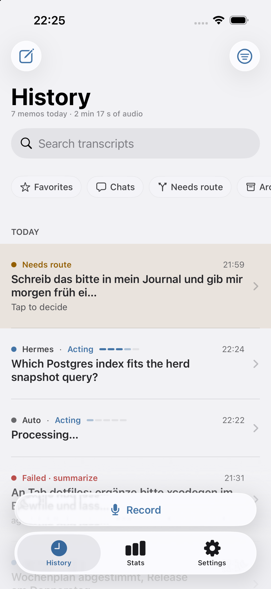
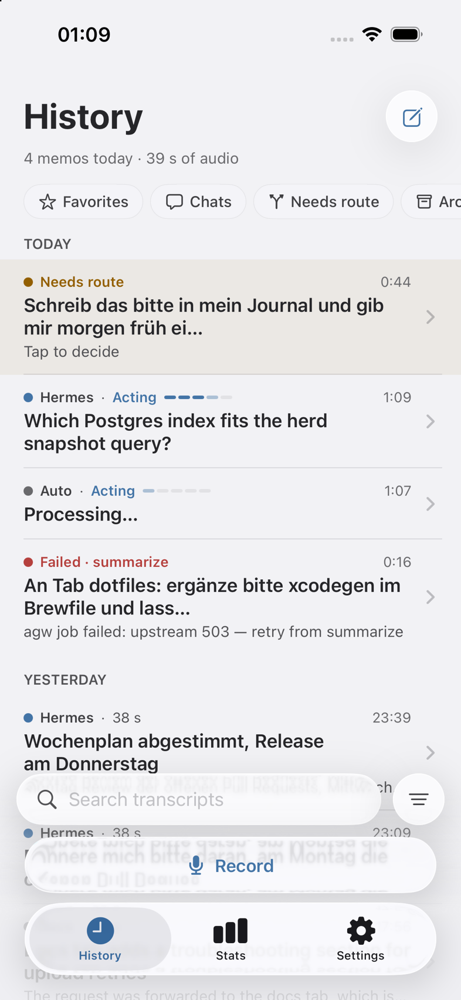
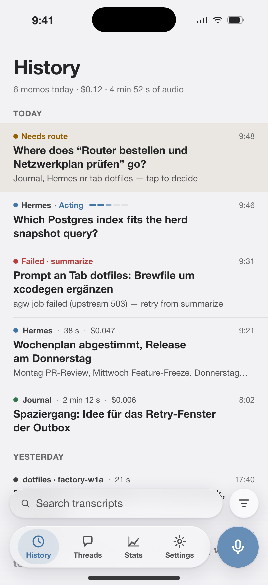
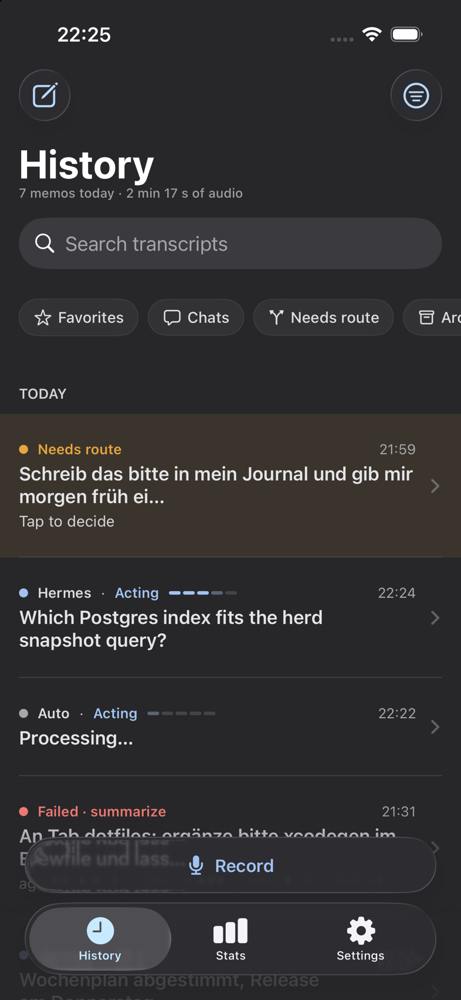
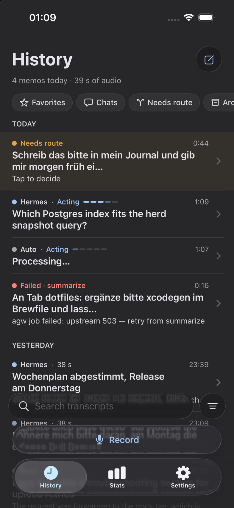
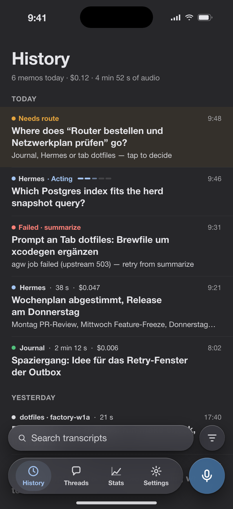

# Fidelity: History (Wave 18 I5)

Reference: `docs/design/mockups/history.html` (round 2; `?v=list|filters|filter-sheet`), renders `r2-history-*`. App shots:
iPhone 15 / iOS 26.5 (the owner's phone class, judged first) and the pinned iPhone 17 / iOS 27.0, light and dark. Values in pt;
the mockup is 402 pt wide, the iPhone 15 393 pt. The scale is `Theme.Spacing` (`IrisUI/Theme/Spacing.swift`).

| | Before (iPhone 15, 26.5) | After (iPhone 15, 26.5) | Mockup |
|-|-|-|-|
| Light |  |  |  |
| Dark |  |  |  |

iPhone 17 / 27.0 after: [light](history/after-i17-light.png), [dark](history/after-i17-dark.png). Same rhythm as 26.5.

## Deltas

| Screen | Element | Mockup | App before | Fix (role in `Theme.Spacing`) |
|-|-|-|-|-|
| List top | Navigation bar | none: status bar, then the title | a 44 pt glass button row (compose, filter) above the title; title baseline ~140 pt from the top vs ~100 | bar hidden; compose moved into the title row; filter into the bottom bar |
| List top | Title | 30 pt bold, leading 20, 18 above, 6 below | system large title, leading 16 | `HistoryTitleBlock`: `screenMargin`, `titleTop`, `titleBottom` |
| List top | Subtitle | 13 pt faint, leading 20, 6 below | system subtitle, leading 16 | same block, `titleBottom` |
| List top | Search | floating glass capsule above the dock, 44 pt, side inset 14, with a round 44 pt filter button and a count badge | search field in the navigation drawer under the title; filter button in the top bar | `HistorySearchBar` in a bottom `safeAreaInset`: `barInset`, `barGap`, `barControlSize`; badge shows `sheetFilterCount` |
| Chips | Leading margin | 20 | 16 | `screenMargin` (as scroll content margin) |
| Chips | Gap | 6 | 8 | `chipGap` |
| Chips | Gap above the row | 8 | 25 (search drawer plus list row inset) | `chipRowTop`, list row insets zero |
| Chips | Height / padding | 30 / 12 | ~30 (text plus 8 above and below) | `FilterChip(size: .compact)` (`chipHeight` as `minHeight`, `chipInsetHorizontal`), set only in the History bar; the composer and route sheet keep `.standard`, the original sizing |
| Controls | Tap area | n/a | chips 30 pt, filter-sheet chips 36 pt, search clear button ~17 pt | 44 pt (`tapTarget`) with the drawn shape unchanged: a content shape on the chips (`chipTapOverhang` comes out of the space around the row), `lineSpacing` in the sheet's flow layout, a 44 pt clear button reaching into the capsule's padding |
| Search | Field height | 44 | fixed 44 | `minHeight` 44 plus `sm` vertical padding, so Dynamic Type can grow it |
| Sections | Gap from chips to day label | 14 | 49 | `sectionTop`; `listSectionSpacing(0)`, `defaultMinListHeaderHeight` 0 |
| Sections | Day label to first row | 6 + row padding 12 | 37 | `sectionBottom`; header insets `screenMargin` |
| Sections | Day label leading | 20 | 16 | `headerInsets` (`screenMargin`) |
| Rows | Vertical padding | 12 above and below | about 28 from the separator to the first text line (8 in the row plus the list's default inset) | `rowVertical` through `listRowInsets`; the row view carries none |
| Rows | Leading / trailing | 20 / 20 | 16 / 16 | `screenMargin` |
| Rows | Gap between lines | 3 | 4 | `rowLineGap` |
| Rows | Gap between status and time | 12 | 8 | `rowColumnGap` |
| Rows | Gap dot / route / duration | 7 | 8 | `snug` (6; 7 is not on the scale) |
| Rows | Separator inset | leading 20, runs to the edge | leading 16 | follows the row inset (`screenMargin`) |
| Rows | Needs-route tint | warn at 7 % | warn at 10 % | `HistoryRowBackground` 0.07 |
| Filter sheet | Side padding | 18 | 24 | `sheetInset` |
| Filter sheet | Space between groups | 12 | 16 | `md` |
| Filter sheet | Chip | 36 pt, 15 pt text, side 14 | same height as the row chips, 13 pt text | `FilterChip(size: .regular)`: `chipHeightLarge`, `subheadline` |
| Filter sheet | Space above the button | 18 | 16 | `sheetInset` |
| Toast | Side and bottom inset | none drawn; floating bars use 14 | 16 | `barInset` |
| Pinned area | Needs-route rows | tinted first rows | same | unchanged (covered by the row rows above) |

## Not changed (owner decision, or system chrome)

| Element | Mockup | App | Why |
|-|-|-|-|
| Bottom dock | four tabs (History, Threads, Stats, Settings) and a round record button | three system tabs and a full-width Record accessory | Threads is a History row (round 2 decision) and the accessory is Wave 15's; both are structure, not spacing. The search bar floats above them |
| Row chevron | none | disclosure chevron from `NavigationLink` | replacing it means replacing the row's tap and accessibility mechanism; the row text keeps the mockup's 20 pt trailing margin |
| Swipe actions, pull to refresh | not drawn | system | no render to match |
| Row separators | 0.5 pt `--divider` | system separator colour | iOS draws it |

## Left on the scale's edge

`HistorySearchBar` badge: 18 pt minimum width (a control size). `HistoryRow` meta gap is 6 where the mockup has 7.
